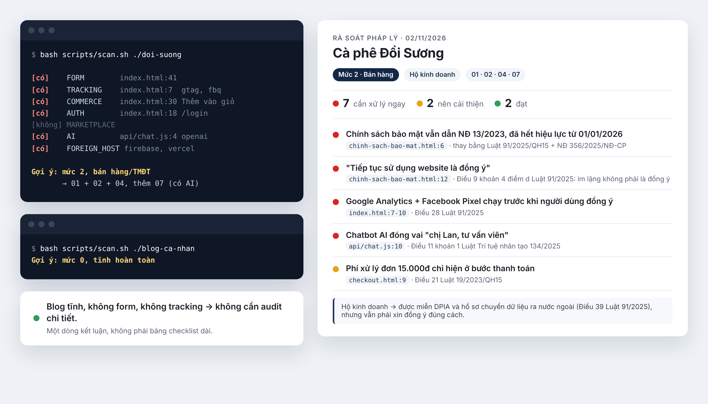

# vn-law-check

**Vietnamese law compliance audit for AI coding agents.** Ask your agent to "audit this site against Vietnamese law" and it scans the code, then points to the exact file and line that may conflict with Vietnamese regulations, with the article it relates to. Then ask it to fix them.

Free and open source. Works with Claude Code, Cursor, GitHub Copilot, Windsurf, Cline and Codex. Covers websites and mobile apps.

[Tiếng Việt](README.md)



## Why

Vietnam replaced most of its digital laws in 2025-2026:

- **Personal Data Protection Law 91/2025/QH15** and **Decree 356/2025/NĐ-CP**, in force since 1 Jan 2026 (replacing Decree 13/2023)
- **Decree 330/2026/NĐ-CP** on penalties for personal data violations, in force since 19 Aug 2026 (up to VND 3 billion for organizations; 5% of revenue for cross-border transfer violations)
- **E-commerce Law 122/2025/QH15** and **Decree 248/2026/NĐ-CP**, in force since 1 Jul 2026
- New Cybersecurity Law 116/2025, amended Advertising Law 75/2025, and the **AI Law 134/2025** (transparency for chatbots and AI-generated content)

Most compliance tooling targets GDPR or CCPA. If you build for Vietnamese users, or your site has a signup form, Google Analytics, a cart or a chatbot, these rules apply to you, and the official texts are only in Vietnamese.

## What it checks

- Consent: pre-checked boxes, "by continuing you agree", trackers firing before consent
- Privacy policy content, and policies still citing the expired Decree 13/2023
- Cookie banners and ad tracking (Facebook Pixel, Google Ads, TikTok Pixel)
- Cross-border data transfer when data sits on Firebase, Vercel, OpenAI and similar
- E-commerce disclosures, hidden fees, fake countdowns
- AI chatbots that pretend to be human staff
- Mobile apps: permissions, tracking and ad SDKs, account deletion, in-app ads

Each finding is rated 🔴 fix now / 🟡 should improve / 🟢 OK / ⚪ not applicable, and cites the specific law and article. Static sites with no forms or tracking get a one-line verdict instead of a long report.

It can also draft a privacy policy, consent form and cookie banner based on what your code actually collects.

## Install

Claude Code:

```
/plugin marketplace add mhfed/vn-law-check
/plugin install vn-law-check
```

Any agent that supports the skills CLI:

```bash
npx skills add mhfed/vn-law-check
```

Cursor, Copilot, Windsurf, Cline, Codex (run in your project folder):

```bash
curl -fsSL https://raw.githubusercontent.com/mhfed/vn-law-check/main/install.sh | bash
```

## Use

```
audit this website against Vietnamese law
```

No source code? Give it a URL:

```
audit https://your-site.vn against Vietnamese law
```

Reports are written in Vietnamese by default. Ask for English if you need it.

## Limits

This is a first-pass review tool, not legal advice. Every report says so at the top. Items the maintainers could not verify against the full legal text are marked `CHƯA XÁC MINH` (unverified), and the agent is told not to invent article numbers or fine amounts. Corrections are logged publicly in the [correction history](sources/legal-references.md#lịch-sử-đính-chính-nội-dung-luật).

Guides (Vietnamese): [mhfed.github.io/vn-law-check](https://mhfed.github.io/vn-law-check/)

## Contributing

Corrections from people who read Vietnamese law closely are the most valuable contribution. See open [`cần xác minh`](https://github.com/mhfed/vn-law-check/issues?q=is%3Aissue+is%3Aopen+label%3A%22c%E1%BA%A7n+x%C3%A1c+minh%22) (needs verification) issues and [CONTRIBUTING.md](CONTRIBUTING.md).

MIT license for the code and structure. Vietnamese legal texts cited are public documents of the State.
