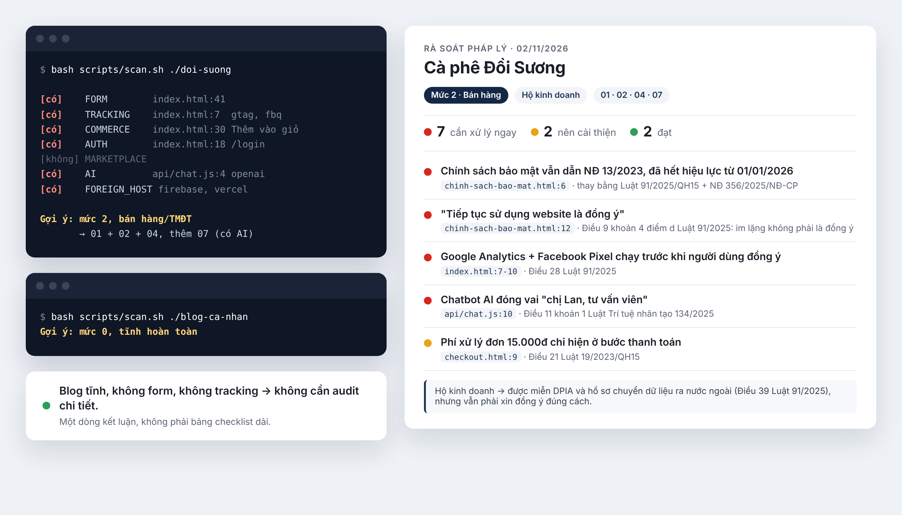

# vn-law-check

Open-source compliance audit for Vietnamese websites and apps. Bảo AI coding agent rà soát các rủi ro pháp lý theo luật Việt Nam và gợi ý chỗ cần sửa trước khi ra mắt.

Dùng cho Claude Code, Cursor, Copilot, Windsurf, Cline, Codex. Hỗ trợ cả website lẫn mobile app.

[English](README.en.md)



## Nó giúp gì?

Nếu website hoặc app của bạn có một trong các dấu hiệu sau thì nên check ngay:

- form thu thập email, số điện thoại, họ tên
- Google Analytics, Meta Pixel, TikTok Pixel, ads SDK
- đăng nhập, giỏ hàng, thanh toán, đặt lịch
- chatbot AI hoặc tool AI trên frontend
- cookie banner, privacy policy, consent flow
- nội dung quảng cáo, chính sách hoàn tiền, điều khoản sử dụng

Từ 01/01/2026, Luật Bảo vệ dữ liệu cá nhân 91/2025 yêu cầu rõ ràng hơn về mục đích thu thập, đồng ý, lưu trữ và chia sẻ dữ liệu. Nhiều doanh nghiệp nhỏ và startup đang phát triển nhanh nhưng bỏ qua các điểm này. Repo này giúp bắt lỗi sớm trước khi bị phạt hoặc bị khách phản hồi.

Bạn không cần đọc luật từ đầu. Chỉ cần cho AI biết project hoặc URL, nó sẽ phân loại site, rà soát các checklist dựa trên luật Việt Nam và trả về báo cáo có mức ưu tiên: 🔴 cần sửa ngay, 🟡 nên cải thiện, 🟢 đạt, ⚪ không áp dụng.

## Vì sao repo này có giá trị?

- Tập trung vào luật Việt Nam, hiện đang có rất ít tool open-source theo đúng quy định mới nhất.
- Dành cho đội dev và AI agent: bạn không cần đọc luật dài, chỉ cần “audit pháp lý website này”.
- Có thể dùng từ giai đoạn xây dựng sản phẩm, không cần chờ legal team review toàn bộ.
- Cung cấp nguồn tham chiếu, checklist và tài liệu để kiểm tra lại.

## Kết quả trông như thế nào?

Trích từ [báo cáo trên site demo](demo/report.md), một shop cà phê giả lập:

> **🔴 Coi việc "tiếp tục sử dụng website" là đồng ý**
> - `chinh-sach-bao-mat.html:12`: "Bằng việc tiếp tục sử dụng website, bạn được xem là đã đồng ý..."
> - Căn cứ: Điều 9 khoản 4 điểm d Luật 91/2025/QH15: im lặng hoặc không phản hồi không được coi là đồng ý.
> - Đề xuất: bỏ câu này, xin đồng ý rõ ràng tại đúng chỗ thu thập dữ liệu.

Mỗi lỗi được xếp mức: 🔴 cần xử lý ngay, 🟡 nên cải thiện, 🟢 đạt, ⚪ không áp dụng. Blog hay trang tĩnh không thu thập gì thì chỉ nhận về 1 dòng nhắn ngắn; nhưng site bán hàng, có login, tracking hoặc AI chatbot thì báo cáo sẽ dài và chi tiết hơn.

## Dùng thế nào?

**Bước 1: cài.** Chọn theo tool bạn đang dùng.

Claude Code (gõ trong Claude Code, không phải terminal):

```
/plugin marketplace add mhfed/vn-law-check
/plugin install vn-law-check
```

Cursor, Windsurf, Copilot, Cline, Codex (chạy trong thư mục project):

```bash
curl -fsSL https://raw.githubusercontent.com/mhfed/vn-law-check/main/install.sh | bash
```

<details>
<summary>Cách cài khác</summary>

Clone thẳng vào thư mục skills của Claude, không qua marketplace:

```bash
git clone --depth=1 https://github.com/mhfed/vn-law-check ~/.claude/skills/vn-law-check
```

Muốn cài riêng cho 1 project thì đổi `~/.claude/skills/` thành `.claude/skills/` trong project đó.

`install.sh` cài checklist vào `.vn-law-check/` và không ghi đè file nào của bạn. Nếu project đã có `AGENTS.md`, `CLAUDE.md`... thì script chỉ chèn thêm một đoạn ngắn tóm tắt để AI biết cách dùng toolkit.
</details>

**Bước 2: bảo AI kiểm tra.** Mở project rồi gõ:

```
audit pháp lý website này theo luật Việt Nam
```

Không có source code, chỉ có địa chỉ website cũng được:

```
audit pháp lý https://ten-mien-cua-ban.vn
```

**Bước 3: sửa.** Đọc báo cáo, rồi bảo tiếp: "sửa giúp các mục 🔴".

Chưa có chính sách bảo mật, hoặc có mà copy từ đâu đó? Bảo tiếp:

```
soạn chính sách bảo mật cho dự án này
```

Agent soạn một bản nháp dựa trên code của bạn: site đang thu dữ liệu gì, gửi cho dịch vụ nào (Google Analytics, Firebase, OpenAI...), rồi gợi ý sửa form đồng ý, banner, privacy policy, và các điểm cần cân nhắc trước khi ship.

> Lưu ý: Repo này chỉ hướng dẫn AI làm rà soát sơ bộ, không đảm bảo kết quả đúng luật 100%. Mục tiêu là giúp bạn biết mình đang thiếu gì và cần chốt ở đâu. Nếu có hoạt động nhạy cảm về thu thập dữ liệu, thanh toán, quảng cáo hoặc AI, nên có bên pháp lý review lại.

## Hỏi nhanh

**Có thay được luật sư không?** Không. Kết quả do AI tạo, chỉ để tham khảo, giúp bạn biết mình đang thiếu gì. Đừng hoảng khi thấy 🔴: phần lớn là chỉnh sửa nhỏ trong code, làm được trong vài giờ. Việc gì quan trọng thì hỏi lại người làm luật. Xem [DISCLAIMER.md](DISCLAIMER.md).

**Mình không dùng AI agent thì sao?** Hiện tại cần một trong các tool ở trên. Bạn vẫn có thể đọc thẳng các checklist trong [`references/`](references/) như một danh sách kiểm tra cho team.

**Có tốn tiền không?** Repo miễn phí. Chi phí duy nhất là lượt dùng AI trong tool bạn đang có sẵn.

**Theo luật nào?** Các văn bản mới nhất, đối chiếu lần gần nhất ngày 03/11/2026:
- Luật Bảo vệ dữ liệu cá nhân 91/2025 + NĐ 356/2025
- Luật Thương mại điện tử 122/2025 + NĐ 248/2026
- Luật An ninh mạng 116/2025 + NĐ 333/2026
- Luật Quảng cáo sửa đổi 75/2025 + NĐ 342/2025
- Luật Trí tuệ nhân tạo 134/2025 + NĐ 142/2026
- Luật Bảo vệ quyền lợi người tiêu dùng, Luật Giao dịch điện tử

Link toàn văn ở [`sources/legal-references.md`](sources/legal-references.md).

**Khác gì các skill compliance khác?** Các bộ có sẵn gần như toàn GDPR, CCPA. Chưa có bộ nào theo luật Việt Nam, trong khi luật VN vừa thay gần hết trong 2025-2026.

## Góp ý: không cần biết code

Mình là dev, không phải luật sư. Chỗ nào chưa đối chiếu được với toàn văn, mình ghi thẳng "CHƯA XÁC MINH". Hiện còn vài chục chỗ như vậy, phần lớn ở các giao dịch/thu thập dữ liệu có tính chất đặc thù.

**Muốn giúp mà chưa biết bắt đầu từ đâu?** Có sẵn [12 việc cần đối chiếu](https://github.com/mhfed/vn-law-check/issues?q=is%3Aissue+is%3Aopen+label%3A%22c%E1%BA%A7n+x%C3%A1c+minh%22), mỗi việc chỉ cần tìm một điều luật và comment kèm link văn bản gốc.

Thấy chỗ sai khác thì [mở issue](https://github.com/mhfed/vn-law-check/issues/new/choose). Form bằng tiếng Việt, điền mất khoảng 1 phút:

- **Báo sai:** sai số điều, văn bản hết hiệu lực, mức phạt chưa đúng
- **Đề xuất bổ sung:** luật mới, lỗi hay gặp mà checklist chưa có
- **Phân loại sai:** tool xếp nhầm loại site của bạn

Kèm link văn bản gốc là mình kiểm tra được ngay. Mọi góp ý được nhận đều ghi tên người góp ý trong bản cập nhật. Chi tiết ở [CONTRIBUTING.md](CONTRIBUTING.md).

Mọi chỗ từng ghi sai và đã sửa được liệt kê ở [lịch sử đính chính](sources/legal-references.md#lịch-sử-đính-chính-nội-dung-luật), để ai dùng bản cũ biết cần xem lại gì. Lỗi đầu tiên do cộng đồng bắt: miễn trừ cho hộ kinh doanh nằm ở Điều 38 chứ không phải Điều 39.

Cảm ơn [@anhtahaylove](https://github.com/anhtahaylove) đã sửa lỗi cài qua `npx skills add` và giúp `scan.sh` nhận ra nút "Đặt hàng".

## Mời mình ly cà phê

Repo miễn phí và sẽ luôn miễn phí. Nếu nó giúp bạn đỡ một buổi lội luật, mời mình ly cà phê để có động lực cập nhật tiếp nhé ☕


TPBank · NGUYEN MINH HIEU · 62626926789

## Dành cho dev: cấu trúc repo

Cùng một nội dung, đặt ở nhiều file để mỗi tool tự đọc đúng chỗ:

- `AGENTS.md`: chuẩn chung (Cursor, Codex, Jules, Amp, Zed...)
- `CLAUDE.md`: Claude
- `SKILL.md`: Claude Skill
- `.claude-plugin/marketplace.json` + `plugins/vn-law-check/`: plugin Claude Code
- `.cursor/rules/vn-legal-compliance.mdc`: Cursor
- `.windsurfrules`: Windsurf
- `.github/copilot-instructions.md`: GitHub Copilot
- `.clinerules`: Cline

### Cấu trúc

```
references/   00-triage (phân loại site trước khi audit) + 9 checklist theo lĩnh vực, có 1 checklist cho mobile app
              10-generate-policy: hướng dẫn soạn chính sách bảo mật, form đồng ý từ kết quả quét
scripts/      scan.sh: quét source code hoặc URL, phát hiện form/tracking/giỏ hàng/đăng nhập/AI/hosting,
              với mobile app: quyền truy cập, SDK tracking/quảng cáo, chức năng xóa tài khoản
              fetch-site.sh: tải trang công khai của một URL để scan.sh quét
sources/      văn bản pháp luật dẫn chiếu, ngày hiệu lực, link
examples/     mẫu báo cáo (rút gọn, đầy đủ) + khung chính sách bảo mật, form đồng ý, banner cookie
tests/        site mẫu để kiểm tra scan.sh phân loại đúng
tools/        sync.sh: sinh các bản copy cho từng tool từ nguồn gốc
```

`scan.sh` quét thư mục code thì chỉ đọc file local. Quét theo URL thì gọi `fetch-site.sh` tải các trang công khai của chính site đó (tối đa 15 trang và 20 file JS cùng lúc để tránh quét quá tải). Hai script không gửi dữ liệu đi đâu khác, không đọc biến môi trường hay credential, không sửa file của người dùng.

## Gửi PR

Xem [CONTRIBUTING.md](CONTRIBUTING.md).

Trang hướng dẫn ở [mhfed.github.io/vn-law-check](https://mhfed.github.io/vn-law-check/) sinh từ `tools/build_site.py`. Sửa nội dung luật ở `references/` thì sửa trang cho khớp rồi chạy `python3 tools/build_site.py`.

MIT license cho phần code và cấu trúc repo. Văn bản pháp luật được dẫn chiếu là tài liệu công khai của Nhà nước, không thuộc phạm vi license này.
