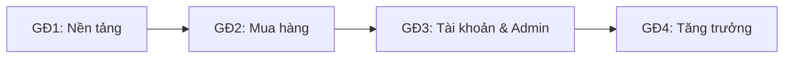

# Đề xuất tính năng — Website Lam Trà

## 0. Hiện trạng hệ thống

Hiện tại `web/` mới có **1 trang landing** ([Landing.tsx](file:///d:/Github/LamTraE-Com/web/components/landing/Landing.tsx)):

- Header (logo, menu, nút tìm kiếm, icon giỏ hàng, nút "Mua ngay")
- Hero (tiêu đề, mô tả, CTA, 3 điểm tin cậy)
- Khung "Trà nổi bật": 5 sản phẩm viết cứng trong code, chọn khối lượng/phân hạng, giá tự tính, nút "Thêm vào giỏ" / "Mua ngay"

Bộ UI kit ([ds/index.tsx](file:///d:/Github/LamTraE-Com/web/components/ds/index.tsx)) mới có: `Icon`, `Button`, `IconButton`, `ProductImage`, `Rating`, `OptionPicker`, `Price`.

> [!WARNING]
> Một số phần đang **chỉ có giao diện, chưa chạy thật**: nút tìm kiếm không làm gì, giỏ hàng chỉ là bộ đếm số, "Mua ngay" không dẫn tới thanh toán, link "Câu chuyện" bị chết, chưa có footer, chưa có routing (mọi thứ nằm trong 1 file), chưa có backend/database.

---

## 1. So sánh với danh sách tính năng của bạn

Ký hiệu: ✅ đã có · 🟡 có một phần · ❌ chưa có

### 1.1 Trang chủ

| Tính năng | Trạng thái | Ghi chú |
|---|---|---|
| Hero (tiêu đề, mô tả, CTA) | ✅ | Đã đẹp, đúng tone thương hiệu |
| Header: logo, menu | ✅ | |
| Header: thanh tìm kiếm | 🟡 | Có icon, chưa có ô tìm kiếm và kết quả |
| Header: giỏ hàng | 🟡 | Chỉ đếm số, chưa mở được giỏ |
| Header: tài khoản người dùng | ❌ | |
| Danh mục nổi bật | 🟡 | Menu nav có, nhưng chưa có khối danh mục trên trang |
| Sản phẩm bán chạy | ❌ | Mới có carousel "Trà nổi bật" 5 món |
| Đánh giá / feedback khách hàng | ❌ | Chỉ có số sao, chưa có lời nhận xét |
| Footer | ❌ | **Bổ sung:** địa chỉ, hotline, Zalo, Facebook, TikTok, link chính sách |

### 1.2 Danh mục & lọc sản phẩm

| Tính năng | Trạng thái |
|---|---|
| Trang danh mục dạng lưới | ❌ |
| Card: ảnh, tên, giá, giá khuyến mãi | 🟡 `Price` chưa hỗ trợ giá gạch ngang |
| Nút thêm nhanh vào giỏ | ❌ |
| Lọc theo danh mục / khoảng giá / rating | ❌ |
| Sắp xếp theo giá / mới nhất | ❌ |

### 1.3 Chi tiết sản phẩm

| Tính năng | Trạng thái |
|---|---|
| Thư viện ảnh nhiều góc | ❌ Mới có 1 ảnh/sản phẩm |
| Mô tả chi tiết | 🟡 Có đoạn mô tả ngắn |
| Thông số kỹ thuật | ❌ |
| Chính sách bảo hành / đổi trả | ❌ |
| Đánh giá & bình luận | ❌ |
| Thêm vào giỏ + Mua ngay | 🟡 Có nút, chưa nối logic |
| Chọn khối lượng + phân hạng | ✅ |

### 1.4 Giỏ hàng & thanh toán

| Tính năng | Trạng thái |
|---|---|
| Trang giỏ: tăng/giảm, xóa | ❌ |
| Mã giảm giá | ❌ |
| Form giao hàng | ❌ |
| Chọn phương thức thanh toán | ❌ (đã ghi chữ "VietQR hoặc COD") |
| Trang đặt hàng thành công | ❌ |

### 1.5 Trang thông tin

| Trang | Trạng thái |
|---|---|
| Về chúng tôi / Câu chuyện | ❌ (link đã có trên menu) |
| Chính sách vận chuyển & đổi trả | ❌ |
| Liên hệ + form | ❌ |

**Tóm lại:** đã có khoảng 15% (phần trang chủ). Các mục 2, 3, 4, 5 chưa có.

---

## 2. Tính năng **danh sách mẫu chưa có** nhưng Lam Trà nên có

Phần này lấy từ brief trong [design system readme](file:///d:/Github/LamTraE-Com/design/prototype/_ds/lam-tr-design-system-49d0718a-2488-4869-a6fa-db2400db4fc1/readme.md) và đặc thù bán trà Việt. Danh sách mẫu là dành cho web bán hàng chung chung nên bỏ sót những mục này.

### 2.1 Đặc thù sản phẩm trà
- **Biến thể khối lượng × phân hạng** (150/300/500g · Hạng 1/2), mỗi biến thể có **giá và tồn kho riêng**
- **Thông số riêng cho trà:** vùng trồng, mùa hái, cách chế biến, hương vị, màu nước, hạn dùng, cách bảo quản
- **Hướng dẫn pha:** nhiệt độ nước, lượng trà, thời gian hãm, số lần pha
- **Gợi ý "Uống hằng ngày" hay "Biếu tặng"**: lọc theo mục đích mua

### 2.2 Quà tặng (nhóm khách mua nhiều nhất)
- Tùy chọn **gói quà + lời nhắn viết tay trên thiệp** khi đặt hàng
- **Giao tới địa chỉ người nhận khác** người mua, có thể ẩn giá trên hóa đơn
- Trang **"Quà biếu"** riêng: theo dịp (Tết, Trung thu, 20/10, tân gia) và theo mức ngân sách
- **Đặt số lượng lớn cho doanh nghiệp** (quà Tết công ty): form báo giá

### 2.3 Thanh toán & sau mua hàng
- **VietQR** sinh mã tự động theo số tiền + mã đơn, nút "Tôi đã chuyển khoản"
- **Theo dõi đơn hàng** 4 bước: Đã đặt → Đã xác nhận → Đang giao → Hoàn thành (component `OrderTracker` đã có trong design system)
- **Tra cứu đơn không cần đăng nhập**, chỉ cần SĐT + mã đơn
- **Thông báo qua Zalo / email / SMS** ở mỗi bước
- **Phí ship theo tỉnh**, miễn ship khi đơn đạt mức nhất định

### 2.4 Tài khoản & giữ chân khách
- Đăng ký / đăng nhập (SĐT + OTP hoặc Zalo/Google)
- Lịch sử đơn, sổ địa chỉ, **mua lại 1 chạm**
- **Danh sách yêu thích** (wishlist)
- Chỉ cho phép đánh giá khi đã mua (nhãn "Đã mua hàng"), cho đính kèm ảnh

### 2.5 Kênh bán & hỗ trợ
- Nút nổi **"Chat Zalo"** (đã có trong brief), link Facebook / TikTok
- **Thanh tab dưới cùng trên mobile** (Trang chủ · Danh mục · Giỏ · Tài khoản), vì phần lớn khách mua bằng điện thoại
- Trang **FAQ** (bảo quản trà, hạn dùng, cách phân biệt hạng)
- **Blog "Trà đàm"**: kiến thức trà, giúp lên SEO

### 2.6 Trang quản trị (Admin), **bắt buộc** để thay việc bán tay
- Quản lý sản phẩm, biến thể, ảnh, tồn kho (báo khi sắp hết hàng)
- Quản lý đơn: xác nhận, đánh dấu đã nhận tiền VietQR, cập nhật trạng thái, in phiếu giao
- Quản lý mã giảm giá & chiến dịch
- Duyệt đánh giá, xem tin nhắn liên hệ
- Báo cáo cơ bản: doanh thu, sản phẩm bán chạy

### 2.7 Kỹ thuật & tin cậy
- **SEO:** metadata từng trang, sitemap, schema `Product` + `Review` (để Google hiện sao), ảnh OG khi share Facebook/Zalo
- **Analytics:** Google Analytics / Meta Pixel / TikTok Pixel
- **Pháp lý VN:** thông tin doanh nghiệp, chính sách bảo mật, điều khoản, logo "Đã thông báo Bộ Công Thương"
- Trang 404, trạng thái đang tải (skeleton), trạng thái rỗng (giỏ trống, không có kết quả)

---

## 3. Mục 6: Phong cách thương hiệu (điền sẵn từ design system)

| Mục | Nội dung |
|---|---|
| **Tông màu chủ đạo** | Xanh rêu `#34472B` / xanh logo `#24341F` + vàng kim `#BC9A6C` + nền kem giấy `#F7F0E3`. Màu chữ than ấm, không dùng đen tuyệt đối |
| **Font** | Roboto (đủ dấu tiếng Việt), phân cấp bằng cỡ chữ và độ đậm |
| **Mood** | Thanh lịch, mộc mạc, ấm áp. Như một phòng trà truyền thống được làm hiện đại, ảnh chụp làm chủ đạo |
| **Tone giọng** | Như người chủ quán trà am hiểu: ấm áp, điềm đạm, chính xác. Kể về vùng trồng, cách sao, hương vị thay vì hô hào khuyến mãi. Gọi khách là "bạn", xưng "Lam Trà". Không emoji, không "SALE SỐC!!!" |
| **Khách hàng mục tiêu** | Nam và nữ 28–40 tuổi, thu nhập trung bình khá trở lên, mua để uống hằng ngày hoặc **biếu tặng**, chủ yếu mua trên điện thoại |

---

## 4. Lộ trình đề xuất

| Giai đoạn | Nội dung | Kết quả |
|---|---|---|
| **GĐ1: Nền tảng** | Tách routing (`/`, `/san-pham`, `/san-pham/[slug]`, `/gio-hang`, `/thanh-toan`…), dữ liệu sản phẩm ra file riêng, Header/Footer dùng chung, thanh tab mobile, bổ sung UI kit (`ProductCard`, `Input`, `QuantityStepper`, `Badge`, `Toast`, `Dialog`) | Khung web nhiều trang |
| **GĐ2: Mua hàng (MVP)** | Trang chủ đầy đủ (bán chạy, danh mục, đánh giá), trang danh mục + lọc/sắp xếp, trang chi tiết, giỏ hàng (lưu localStorage), mã giảm giá, checkout + VietQR/COD + gói quà, trang đặt hàng thành công, các trang thông tin + liên hệ | **Bán được hàng thật** |
| **GĐ3: Tài khoản & Admin** | Backend + DB, đăng nhập, lịch sử đơn, theo dõi đơn, wishlist, đánh giá có ảnh, admin panel, thông báo Zalo/email | Thay được việc bán tay |
| **GĐ4: Tăng trưởng** | Blog, SEO schema, pixel, quà doanh nghiệp, chương trình khách thân thiết | Tăng traffic và đơn quay lại |

> [!IMPORTANT]
> **Cần bạn quyết định trước GĐ2/GĐ3:**
> 1. **Backend:** Supabase (nhanh, có auth + DB), Next.js API + PostgreSQL/Prisma, hay tạm dữ liệu tĩnh + Google Sheet?
> 2. **Thanh toán online:** chỉ VietQR + COD, hay tích hợp thêm cổng VNPay / MoMo / PayOS (PayOS tự xác nhận khi nhận được tiền VietQR)?
> 3. **Đăng nhập:** SĐT + OTP, Zalo, Google, hay cho mua không cần tài khoản?
> 4. **Vận chuyển:** phí cố định theo vùng, hay nối API GHN / GHTK để tính phí tự động?
