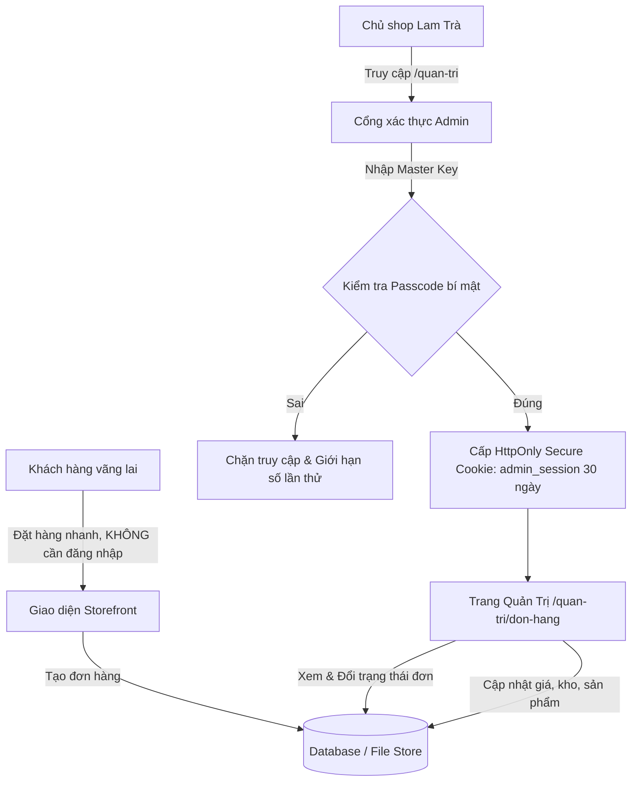

# Đề xuất giải pháp: Xây dựng Trang Quản Trị (Admin) cho Lam Trà

Tài liệu phân tích và đề xuất phương án tối ưu để xây dựng trang quản trị đơn hàng, sản phẩm và tin nhắn cho **Lam Trà**, đảm bảo tiêu chí: **Khách mua hàng tiếp tục không cần đăng nhập**, nhưng **Trang Admin vẫn an toàn, bảo mật, nhẹ nhàng và tiện lợi nhất cho chủ shop**.

---

## 1. Đặt vấn đề & Nguyên tắc cốt lõi

### 1.1. Hiện trạng cửa hàng
- **Phía khách hàng**: Đang áp dụng luồng đặt hàng nhanh (**Guest Checkout**), không yêu cầu tạo tài khoản hay đăng nhập. Đây là ưu điểm cực kỳ lớn của thương mại điện tử cao cấp tại Việt Nam (khách mua quà, biếu tặng chốt đơn trong 30 giây qua tên, SĐT, địa chỉ và VietQR).
- **Phía quản trị**: Đơn hàng hiện được lưu vào file `.data/orders.jsonl` và có hỗ trợ gửi Webhook sang Google Sheet/Telegram qua `LAMTRA_WEBHOOK_URL`. Tuy nhiên, chưa có giao diện trực quan trên web để:
  - Xem danh sách đơn hàng mới.
  - Đổi trạng thái đơn (Mới đặt → Đã xác nhận tiền → Đang giao → Hoàn thành).
  - Điều chỉnh giá bán, tồn kho hoặc ghi chú nội bộ.

### 1.2. Nguyên tắc thiết kế giải pháp
1. **Không xáo trộn trải nghiệm khách hàng**: Web bán hàng tiếp tục 100% không bắt buộc đăng nhập.
2. **Bảo mật tuyệt đối thông tin khách hàng**: Số điện thoại, địa chỉ nhận hàng và doanh thu của shop không được để lộ ra ngoài.
3. **Chi phí 0đ & triển khai nhanh**: Không dùng các dịch vụ bên thứ ba đắt đỏ hay phức tạp.
4. **Tiện dụng trên điện thoại**: Chủ shop có thể mở điện thoại ra duyệt đơn, bấm gọi khách hoặc nhắn Zalo xác nhận chỉ với 1 chạm.

---

## 2. So sánh 4 Phương án Xử lý

| Tiêu chí | Phương án 1: Master Secret Key (Khuyên dùng) | Phương án 2: OTP / Magic Link Telegram | Phương án 3: Quản lý qua Google Sheet | Phương án 4: NextAuth / Supabase Auth |
| :--- | :--- | :--- | :--- | :--- |
| **Độ phức tạp** | ⭐ Rất thấp (1 ngày) | ⭐⭐ Trung bình (2 ngày) | ⭐ Rất thấp (Có sẵn webhook) | ⭐⭐⭐ Cao (3-4 ngày) |
| **Bảo mật** | Rất cao (Cookie HttpOnly + SHA256) | Rất cao (Không mật khẩu) | Phụ thuộc bảo mật tài khoản Google | Rất cao (OAuth chuẩn) |
| **Tác động web khách** | **0% (Không ảnh hưởng)** | **0% (Không ảnh hưởng)** | **0% (Không ảnh hưởng)** | Có thể làm nặng bundle nếu cấu hình chung |
| **Tiện dụng di động** | Nhập mã 1 lần, lưu phiên 30 ngày | Bấm link từ tin nhắn Telegram | Dùng Google Sheets App | Đăng nhập tài khoản Google |
| **Chi phí hạ tầng** | 0 VNĐ | 0 VNĐ (Telegram Bot free) | 0 VNĐ | 0 VNĐ (giai đoạn đầu) |

---

## 3. Chi tiết Phương án Khuyên Dùng (Phương án 1: Admin Master Key / Passcode)

Đây là giải pháp được áp dụng rộng rãi nhất cho các website thương hiệu thủ công, indie e-commerce vì tính độc lập và tốc độ thực thi.



### 3.1. Cơ chế hoạt động
1. **Đường dẫn truy cập**:
   - Sử dụng route riêng biệt: `/quan-tri` (hoặc có thể đổi thành route bí mật trong `.env` như `/quan-tri-lamtra-89` để chống quét tự động).
2. **Cơ chế xác thực**:
   - Chủ shop truy cập lần đầu sẽ thấy màn hình nhập **Mã bảo mật quản trị (Master Passcode)** được thiết kế sang trọng, tối giản.
   - Mã bảo mật được định nghĩa trong `.env`:
     ```env
     ADMIN_SECRET_KEY=<mật-khẩu-riêng-của-bạn>
     ```
   - Khi nhập đúng, server tạo một mã `admin_session` có chữ ký bảo mật (HMAC SHA-256) và lưu vào `Cookie` với cờ `HttpOnly`, `SameSite=Lax`, `Secure`.
   - Phiên đăng nhập kéo dài **30 ngày**, chủ shop không phải gõ lại mỗi lần vào web.
3. **Bảo vệ bằng Next.js Middleware**:
   - File `web/middleware.ts` sẽ tự động kiểm tra cookie với bất kỳ request nào bắt đầu bằng `/quan-tri` hoặc `/api/admin`.
   - Nếu chưa xác thực, tự động chuyển hướng về trang nhập passcode. Người ngoài hay bot hoàn toàn không thể xem dữ liệu đơn hàng hay danh sách khách.

---

## 4. Thiết kế các Tính năng cần có trong Trang Admin

### 4.1. Tab 1: Quản lý Đơn hàng (Trọng tâm số 1)
- **Thống kê tổng quan**: Số đơn mới trong ngày, tổng doanh thu tạm tính, số đơn chờ xác nhận VietQR, số đơn đang trên đường giao.
- **Danh sách đơn hàng (Bảng thông minh)**:
  - Mã đơn (ví dụ: `LTAB12CD`).
  - Thời gian đặt (giờ, ngày).
  - Tên khách hàng & Số điện thoại (kèm nút bấm: **Gọi nhanh** hoặc **Mở chat Zalo** với khách).
  - Địa chỉ giao hàng & Tỉnh/thành.
  - Hình thức thanh toán: **VietQR** (kèm trạng thái khách đã bấm "Tôi đã chuyển khoản" hay chưa) hoặc **COD**.
  - Tổng tiền (VND).
  - Trạng thái hiện tại: `Chờ xác nhận (0)` → `Đã xác nhận (1)` → `Đang giao (2)` → `Hoàn thành (3)` → `Đã hủy (-1)`.
- **Thao tác đơn hàng**:
  - Đổi trạng thái đơn bằng 1 cú nhấp chuột (khách tra cứu tại `/tra-cuu-don` sẽ thấy trạng thái cập nhật theo thời gian thực).
  - Xem chi tiết danh sách từng gói trà, phân hạng, thiệp viết tay đính kèm.
  - Nút **In phiếu gửi hàng / Đóng gói**: Định dạng mẫu in khổ giấy A5/A6 sạch sẽ để dán lên hộp trà.
  - Nút **Xuất file Excel / CSV**: Để đối soát doanh thu cuối tháng.

### 4.2. Tab 2: Quản lý Sản phẩm & Tồn kho
- Danh sách 5 dòng trà hiện tại (Móc Câu, Nõn Tôm, Đinh Sen, Đinh Thượng Hạng, Hộp Quà).
- Chỉnh sửa nhanh:
  - **Giá bán cơ sở** và **Giá khuyến mãi** (compareAt).
  - **Tồn kho**: Báo hết hàng tạm thời cho từng kích cỡ (150g, 300g, 500g) mà không cần can thiệp vào code.
  - Bật / tắt hiển thị sản phẩm trên trang chủ và danh mục.

### 4.3. Tab 3: Tin nhắn liên hệ & Tư vấn
- Hiển thị các lời nhắn khách gửi qua form liên hệ ([/lien-he](file:///d:/Github/LamTraE-Com/web/app/lien-he)):
  - Tên, SĐT, Email, Nội dung câu hỏi.
  - Trạng thái: "Chưa phản hồi" / "Đã liên hệ tư vấn".

---

## 5. Lộ trình Lưu trữ Dữ liệu (Database Strategy)

Để trang admin hoạt động mượt mà khi chỉnh sửa dữ liệu, hệ thống lưu trữ được chia làm 2 giai đoạn:

### Giai đoạn A: Dữ liệu File JSONL cục bộ (Hiện tại)
- **Ưu điểm**: Đã có sẵn module [store.ts](file:///d:/Github/LamTraE-Com/web/lib/server/store.ts). Không cần cài đặt database, chạy ngay lập tức trên máy chủ thử nghiệm hoặc VPS.
- **Cách thức**: Admin cập nhật trạng thái đơn → ghi vào `.data/orders-status.jsonl`. Admin sửa giá trà → ghi vào `.data/products-override.json`.

### Giai đoạn B: Cơ sở dữ liệu đám mây (Khi Deploy Vercel / Cloud chính thức)
- Vì hạ tầng Vercel là Serverless (không cho phép ghi file lâu dài trên đĩa cứng), giải pháp tối ưu nhất là kết nối với:
  - **Supabase PostgreSQL** (Gói miễn phí vĩnh viễn): Lưu trữ toàn bộ Đơn hàng, Sản phẩm, Tồn kho.
  - Hoặc **Google Sheets API**: Biến Google Sheet thành database mini vừa hiển thị trên web admin vừa đồng bộ về bảng tính của chủ shop.

---

## 6. Kế hoạch Triển khai (Step-by-Step)

Nếu bạn đồng ý với phương án này, cấu trúc file triển khai sẽ gồm:

```
web/
├── middleware.ts                   # Chặn và bảo vệ toàn bộ route /quan-tri và /api/admin
├── app/
│   ├── quan-tri/
│   │   ├── page.tsx               # Màn hình đăng nhập Passcode & Dashboard điều hướng
│   │   ├── don-hang/
│   │   │   └── page.tsx           # Quản lý danh sách & chi tiết đơn hàng
│   │   ├── san-pham/
│   │   │   └── page.tsx           # Bật tắt sản phẩm, sửa giá và tồn kho
│   │   └── lien-he/
│   │       └── page.tsx           # Xem tin nhắn tư vấn từ khách
│   └── api/
│       └── admin/
│           ├── auth/route.ts      # Xác thực passcode và cấp cookie
│           ├── orders/route.ts    # Lấy danh sách & cập nhật trạng thái đơn
│           └── products/route.ts  # Cập nhật giá & tồn kho
```

---

> [!TIP]
> **Khuyến nghị thực hiện**: Bạn có thể bắt đầu ngay với **Phương án 1 (Master Passcode)** kết hợp với giao diện quản lý đơn hàng. Cách làm này vừa nhanh (chỉ mất ít thời gian triển khai), vừa an toàn tuyệt đối, lại giữ nguyên luồng mua hàng thông thoáng không cần đăng nhập cho khách.
